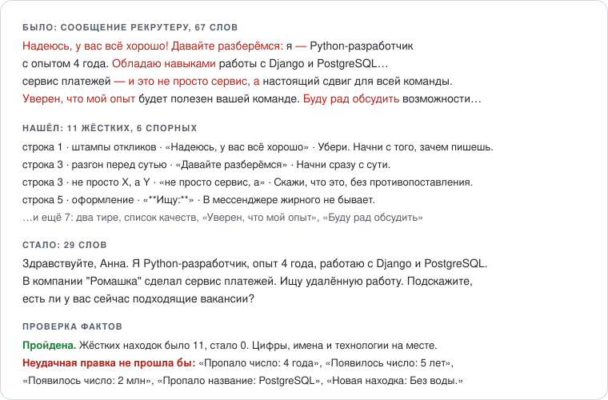

<p align="center"></p>

<h1 align="center">Чистовик</h1>

<p align="center">Находит в русском тексте приметы нейросети и правит только их.</p>

Отклик рекрутеру, пост, README или письмо часто пишутся с помощью нейросети, и это видно по первой строке: «Надеюсь, у вас всё хорошо», «это не просто сервис, а», длинные тире, жирные подписи в Telegram. Чистовик находит такие места скриптом, правит только их и потом сверяет результат с исходником. Если при правке пропало число, поменялась единица или появились цифры и названия, которых не было, проверка не проходит.

Готовые инструменты вроде [unslop](https://github.com/theclaymethod/unslop) рассчитаны на английский, и русских штампов их проверки не видят. Здесь каталог собран под русский язык: канцелярит, штампы откликов на hh, кальки вроде «глубокого погружения», правила для чата, резюме и официальных текстов.

<p align="center"></p>

## Установка

**Без терминала.** В Claude Code или Claude Desktop отправь Claude сообщение:

```
Установи скиллы из https://github.com/shardnessS/chistovik
```

Claude сам скачает скилл и положит его куда нужно. В claude.ai так не получится: там скиллы загружают вручную, смотри следующий пункт.

**Claude.ai.** Скачай [chistovik.zip](https://github.com/shardnessS/chistovik/releases/latest/download/chistovik.zip) и загрузи в разделе Skills настроек Claude. Скрипту нужен Python, в claude.ai он работает в среде выполнения кода.

**Claude Code, плагином**

```
/plugin marketplace add shardnessS/chistovik
/plugin install chistovik@chistovik
```

**Через npx skills** — для Claude Code, Cursor, Codex и других агентов:

```bash
npx skills add shardnessS/chistovik -g
```

С `-g` скилл ставится для всех проектов, без него только в текущий.

**Вручную.** Скопируй папку `skills/chistovik` в `~/.claude/skills/`.

## Пример

Запрос: «Почисти, чтобы не было похоже на нейросеть. Это я рекрутеру в телегу отправлю», дальше сообщение на 67 слов.

Сканер в жанре `chat` нашёл 11 жёстких находок и 6 спорных. Среди них «Надеюсь, у вас всё хорошо», «Давайте разберёмся», «Обладаю навыками», «не просто сервис, а», два длинных тире, жирное «**Ищу:**», «Уверен, что мой опыт», «Буду рад обсудить». Правка вышла на 29 слов:

```
Здравствуйте, Анна. Я Python-разработчик, опыт 4 года, работаю с Django и PostgreSQL.
В компании "Ромашка" сделал сервис платежей. Ищу удалённую работу. Подскажите,
есть ли у вас сейчас подходящие вакансии?
```

Сверка с исходником:

```
Чистовик 0.1.0: Проверка пройдена.
Слов было 67, стало 29, изменено около 62%. Жёстких находок было 11, стало 0; спорных было 6, стало 0.
```

Для сравнения та же сверка на неудачной правке, где опыт стал «5 лет», добавились «2 млн транзакций» и «Без воды. Только суть.»:

```
Чистовик 0.1.0: Проверка не пройдена.
Ошибки:
  - Пропало число: «4 года».
  - Появилось число, которого не было: «5 лет».
  - Появилось число, которого не было: «2 млн».
  - Пропало название: «PostgreSQL».
  - Новая находка: Штампы самого правщика [bez_vody] «Без воды.». Это штамп самих «очеловечивателей». Убери.
```

Полный протокол прогона: [examples/protocol.md](examples/protocol.md).

## Что внутри

| Скилл | Что делает |
|---|---|
| `chistovik` | Правка, разбор без правки, новый текст по фактам, голос автора |

Скрипт `scripts/chistovik.py` на стандартной библиотеке Python без сети:

| Команда | Что делает |
|---|---|
| `scan` | 129 фразовых правил и 23 проверки формы: ритм, связки, тире, списки, жирное, эмодзи |
| `check` | Сверка правки с исходником: числа с оговорками и порядком величин, даты, имена, термины, отрицания, требования, новые штампы |
| `golos` | Профиль письма по образцам: длина предложений, тире, ё, ты или вы, смайлики, разговорные слова |
| `genres`, `catalog` | Список жанров и каталог правил |

## Как пользоваться

```
почисти текст, это пост в канал: …
убери ИИ-шность из сопроводительного
проверь на штампы, ничего не меняй
похоже на нейросеть?
напиши рекрутеру, что я ищу удалёнку, без штампов
запомни мой стиль, вот мои сообщения: …
похоже на меня?
```

Жанр Чистовик определяет сам и пишет, какой выбрал. Можно назвать его прямо: чат, резюме, письмо, пост, статья, README, официальный текст.

## Как устроена проверка

**Сканер предлагает, агент решает.** Находка значит «перечитай это место», а не «удали». Термины, цитаты, юридические оговорки и обычные для жанра обороты остаются: «данный договор» в официальном тексте, «уникальный идентификатор» в документации, «вызов функции» в коде. Текст в кавычках и блоки кода сканер не проверяет, поэтому примеры плохих фраз в «кавычках» не считаются ошибкой.

**Жанр меняет правила.** В сообщении рекрутеру жирное, списки и длинные тире жёсткие, а длиннее шести предложений уже много. В README те же списки и тире нормальны, а «мощный инструмент» всё равно отмечается. В официальном тексте канцелярит не трогается совсем.

**Чистый текст остаётся чистым.** Если подтверждённых находок нет, скилл возвращает текст как был. Правки идут только по найденным местам, остальное копируется слово в слово.

**Сверка фактов после правки.** `check` сравнивает исходник и правку. «Около 60%» и «60%» для него разные числа, «47 млн» и «47 млрд» тоже. «Пять лет» и «5 лет», «175 000 ₽» и «175 тыс. ₽» для него одно и то же. «Яндексе» и «Яндекс» тоже одно и то же. Если отрицаний или слов вроде «только» и «обязательно» стало меньше, он предупреждает.

**Штампы самого правщика.** Неумелая чистка меняет воду на новые шаблоны: «Без воды. Только суть.», «Не инструмент. Команда.», «Четыре режима, один вход.». Они в каталоге отдельной категорией, и правка, которая их добавила, проверку не проходит.

**Голос.** Если дать три своих текста одного жанра, скрипт посчитает привычки: длину предложений, тире, букву ё, обращение, смайлики из скобок. Потом можно спросить «похоже на меня?» и получить оценку от 0 до 100 и две-три главные разницы. Образцы хранятся только локально, в `~/.chistovik/golos/`.

## Чего не делает

- Не определяет, кто написал текст. Чистый скан не доказывает, что писал человек, и наоборот.
- Не работает с английским текстом.
- Не проверяет орфографию и не исправляет грамматику.
- Не видит смысловые подмены без чисел и имён: если правка поменяла «рекомендуем» на «требуем», `check` предупредит, но решать будет агент.
- Ловит только то, что есть в каталоге. Новые штампы появляются, каталог надо пополнять.
- Голос оценивает 22 привычки письма. Это грубая мера, не стилометрия.

## Файлы

```
skills/chistovik/SKILL.md                 инструкции скилла
skills/chistovik/scripts/chistovik.py     сканер, сверка фактов, голос
skills/chistovik/references/shtampy.md    каталог правил, собирается из кода
skills/chistovik/references/contract.md   что править и что защищать
skills/chistovik/references/genres.md     жанры и как в них писать
skills/chistovik/references/golos.md      голос автора
skills/chistovik/templates/               форматы ответа: правка и разбор
tests/                                    тесты и примеры «не трогает»
evals/                                    кейсы для ручного прогона и claude plugin eval
examples/protocol.md                      протокол ручного прогона
tools/build.py                            проверка и сборка zip
```

## Проверка

```bash
python -m unittest discover -s tests -v
```

51 тест. Каждое из 129 фразовых правил проверяется на своём примере. У каждой категории есть пример, который правило трогать не должно. Сверка фактов проверяется на пропавших, придуманных и изменённых числах, а каталог на совпадение с кодом.

Кейсы в `evals/`: правка сообщения рекрутеру (главный), разбор без правки, чистый текст, который должен остаться как есть, и сборка голоса.

```
claude plugin eval . --runs 1 --trust-plugin --no-publish
```

## Добавить штамп

1. Добавь правило в `PHRASES` в `skills/chistovik/scripts/chistovik.py` с примером и подсказкой.
2. Если слово бывает буквальным, добавь пример «не трогает» в `tests/fixtures/ne_trogaet.json`.
3. Пересобери каталог: `python skills/chistovik/scripts/chistovik.py catalog > skills/chistovik/references/shtampy.md`.
4. Прогони тесты.

## Автор

[shardness](https://github.com/shardnessS) · Лицензия MIT. Идея сверки после правки и пар «ловит / не трогает» подсмотрена у [unslop](https://github.com/theclaymethod/unslop). Код и каталог написаны заново под русский язык.
